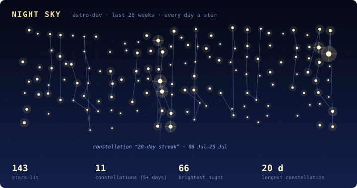
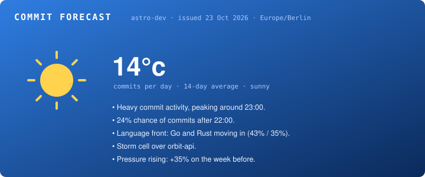
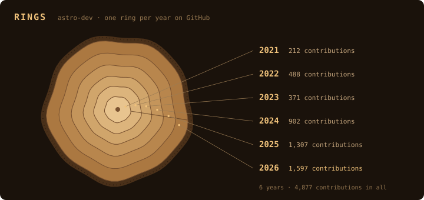

# galaxy-stats

**Your GitHub activity, drawn as a galaxy, a night sky, a `kubectl top` and more.**
Rendered by a GitHub Action inside your own repository. No server, no third-party service, no gaps.

<p align="center">
  
</p>
<p align="center">
  
</p>
<p align="center">
  
</p>

<p align="center">
  
  
</p>
<p align="center">
  
</p>

<sub>Examples rendered from generated demo data.</sub>

## Why another stats card?

- **Runs where your profile lives.** A scheduled workflow renders SVG files and commits them to a branch of your repository. Nothing is hosted, nothing to rate-limit, nothing to shut down.
- **Private work counts, private names don't.** With a token that can read your private repositories, their activity is included, but they show up as *uncharted systems* hidden in fog and as *closed-source* containers. Names are dropped while fetching, before anything is rendered. You can opt in to showing them.
- **No empty sections.** Cards adapt to the data they get: the night sky skips quiet stretches before your activity starts, the galaxy maps whatever you worked on. No "unexpected error" boxes on your profile.
- **Built on stable APIs.** Data comes from the contribution calendar and the commits API, not from event payloads that GitHub has been trimming. A weekly CI job renders real cards against the live API to catch changes early.
- **Small and dependency-free.** A single Go binary using only the standard library, built from source at the exact commit you pin.

## Cards

| Card | What it shows |
|------|---------------|
| `galaxy` | Repositories you committed to in the last 12 months as planets in a spiral galaxy. Size is the number of commits, the world type follows the primary language (ocean, desert, ice, jungle, lava, gas giant with rings), moons count active weeks, and a turning holo ring marks repositories pushed in the last two weeks. Hyperlanes connect repositories you worked on in the same weeks. |
| `nightsky` | The last 26 weeks as a sky: every day is a star whose brightness is that day's contributions. Five or more active days in a row form a constellation. |
| `kubectl` | `kubectl top` for you: active repositories as containers, with commits over 30 days as CPU, repository size as memory and breaks of more than a week as restarts. The footer shows commits per day and how much of your work happens after 22:00. Comes in `dark` and `light`. |
| `pulse` | A heart monitor of the last 60 days: one heartbeat per day, its height the day's contributions, with a sweep line running across the screen. |
| `rings` | Your years on GitHub as the growth rings of a tree, one ring per calendar year. Quiet years are narrow rings, not gaps. |
| `forecast` | The last two weeks as a weather report: commits per day as the temperature, the chance of commits after 22:00, the languages moving in and where the storm is. |

The action renders `galaxy`, `nightsky` and `kubectl` by default; list the ones you want in `cards`.

## Quick start

**1. Add a workflow** to your profile repository (`<you>/<you>`), e.g. `.github/workflows/galaxy-stats.yml`:

```yaml
name: galaxy-stats

on:
  schedule:
    - cron: "23 4 * * *" # daily
  workflow_dispatch:

permissions:
  contents: write

jobs:
  render:
    runs-on: ubuntu-latest
    steps:
      - uses: actions/checkout@3d3c42e5aac5ba805825da76410c181273ba90b1 # v7.0.1
      - uses: msch128/galaxy-stats@3825b5bf550316147b18c883241c6ddbc2971508 # v1.1.0
        with:
          token: ${{ secrets.GALAXY_STATS_TOKEN }} # optional, see below
          timezone: Europe/Berlin
```

**2. Run it once** from the *Actions* tab. The cards land on the `galaxy-stats` branch.

**3. Embed them** in your `README.md`:

```markdown


```

### Token

Without a token the action uses the workflow's `GITHUB_TOKEN` and renders your **public** activity.

To include private repositories, create a token and store it as the repository secret `GALAXY_STATS_TOKEN`:

- **Classic token** with the `repo` scope. This is the tested setup.
- A **fine-grained token** with read-only *Contents* and *Metadata* on all repositories is the least-privilege option, but GitHub may not count private contributions with it. If they are missing, use a classic token.

The token is only used to read. Publishing uses the workflow's own credentials from `actions/checkout`.

## Inputs

| Input | Default | Description |
|-------|---------|-------------|
| `token` | `github.token` | Token used to read your activity. |
| `user` | repository owner | GitHub login to render. |
| `cards` | `galaxy,nightsky,kubectl` | Cards to render, comma-separated: any of `galaxy`, `nightsky`, `kubectl`, `pulse`, `rings`, `forecast`. |
| `timezone` | `UTC` | IANA time zone for commit hours, e.g. `Europe/Berlin`. |
| `theme` | `dark` | `dark` or `light`, for cards that support it. |
| `display-name` | login | Name shown on the cards, e.g. in `kubectl top engineer <name>`. |
| `show-private-names` | `false` | Show private repository names instead of anonymising them. |
| `branch` | `galaxy-stats` | Branch the SVG files are published to. |

The branch always holds a single commit that is replaced when a card changes, so it never grows, and no commit is made when nothing changed.

## Run locally

```sh
export GITHUB_TOKEN=...            # or GALAXY_STATS_TOKEN
go run ./cmd/galaxy-stats -user <you> -timezone Europe/Berlin -out cards
```

`-save-snapshot data.json` stores the fetched data, and `-snapshot data.json` renders from it again without calling the API, which is handy when working on a card. `go run ./cmd/galaxy-stats -h` lists every flag.

## Adding a card

A card is a type with an `ID()` and a `Render(*model.Snapshot, card.Options) ([]byte, error)` method:

1. Create a package under `internal/card/<name>` and draw with the helpers in `internal/svg`.
2. Register it in `internal/cards`.
3. Run `go test ./internal/cards -update` to render its example into `docs/examples`, and review the image.

The shared tests check that every card produces well-formed SVG for empty, sparse and busy accounts, escapes user text, and renders deterministically.

## Privacy

The snapshot a run works from contains dates, counts, languages and sizes. It never contains commit messages, file names or e-mail addresses, and it contains private repository names only with `show-private-names: true`. Everything stays inside your workflow run, and only the rendered SVG files are published.

## License

[MIT](LICENSE)
